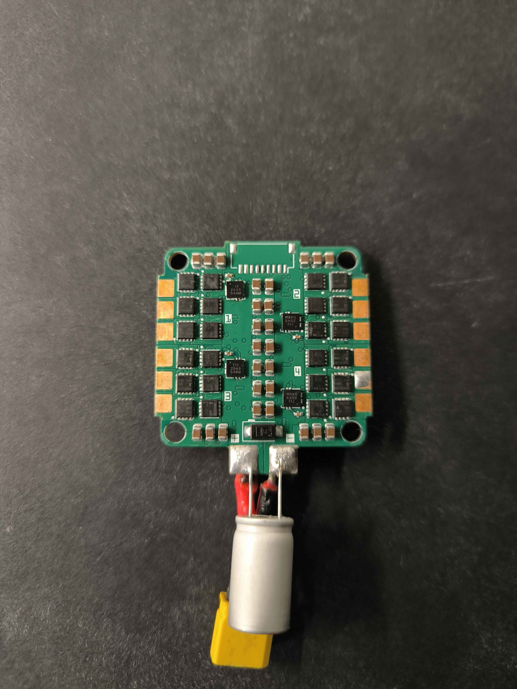
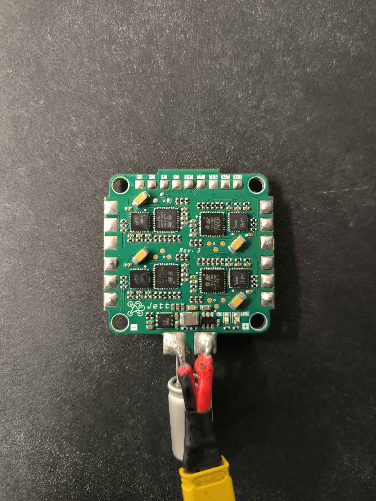
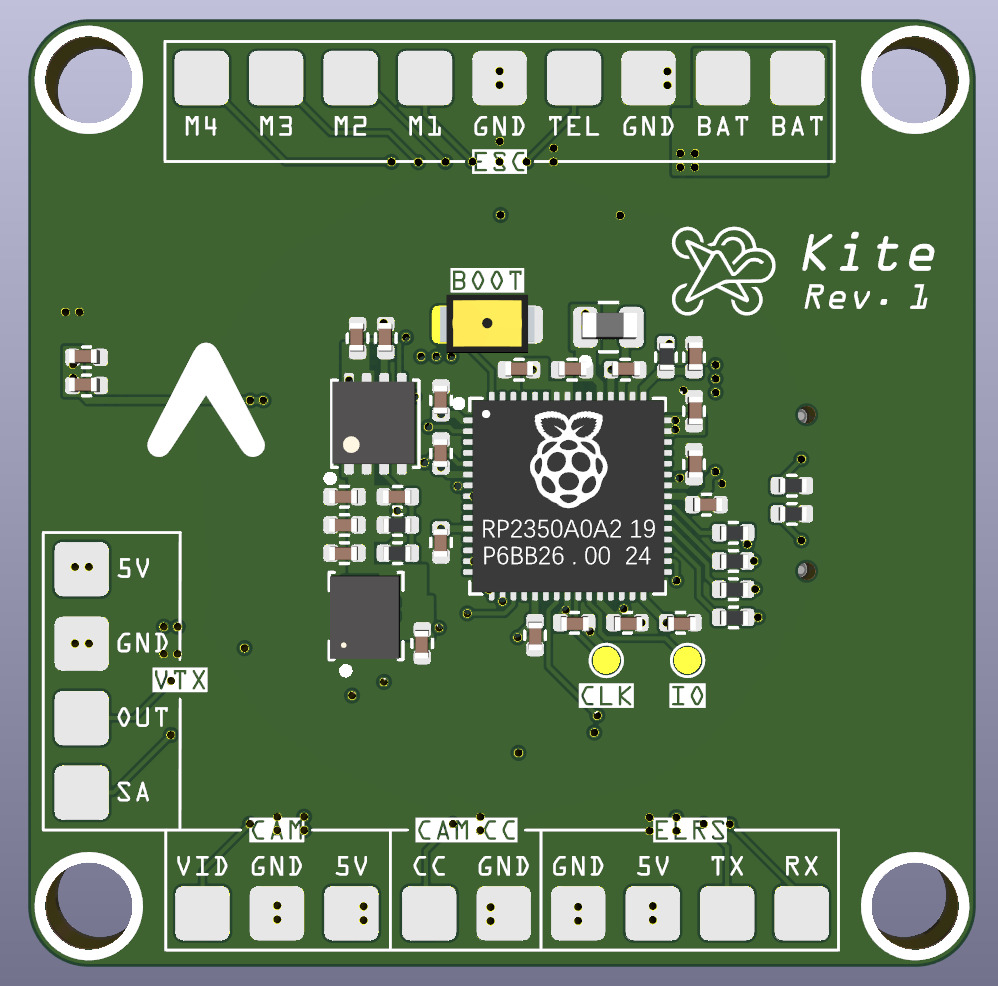
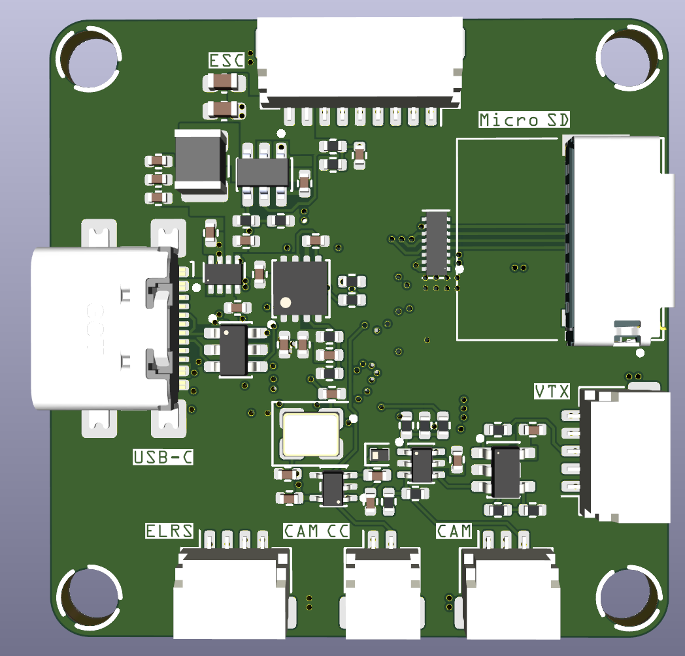

# Stratus

A custom, open source yet practical drone stack.\
Open sourced in the hope that it could serve as a stepping stone in someone else's journey!

## ESC - Jett

  
  

**Current revision:** 3\
**Status:** Testing

### Specs

|                    |                                                    |
| ------------------ | -------------------------------------------------- |
| MCU                | STM32G071K(B/8)U(3/6)                              |
| Gate driver        | DRV8300DRGER                                       |
| Input              | 3S to 5S LiPo                                      |
| Continuous current | 25A, 30A peaks                                     |
| Current sensing    | High side hall effect sensor (ACS711)              |
| Firmware           | AM32                                               |

### Description

Built from the ground up to understand what is happening inside an ESC, rather than treating it as a black box. Jett uses industry standard AM32, and has hardware designed around being able to inspect, modify, and learn from the system.

**Power tree:** `VBAT → 10V buck (driving FETs) → 3.3V low-noise LDO`

## Kite (FC)

  
  

**Current revision:** 1\
**Status:** Waiting for Jett

### Specs

|                    |                                                    |
| ------------------ | -------------------------------------------------- |
| MCU                | RP2354A                                            |
| IMU                | LSM6DSK320X                                        |
| Input              | 3S to 4S LiPo                                      |
| BECs               | 5V → VTX + Camera; 3V3 → MCU + IMU                 |
| Storage            | MicroSD                                            |
| Firmware           | Betaflight                                         |

The flight controller completes the Stratus stack, with the same focus on practical hardware and understanding the underlying system.

## Acknowledgements <3

Thank you to:
- **AlkaMotors**, **brushlesspower** for the endless patience and willingness to share experience.
- **anticitizen**, **Diamond Master** for design reviews and contributions.

This project would not have been possible without you!

## License

CERN-OHL-S-2.0, see [LICENSE](LICENSE).
